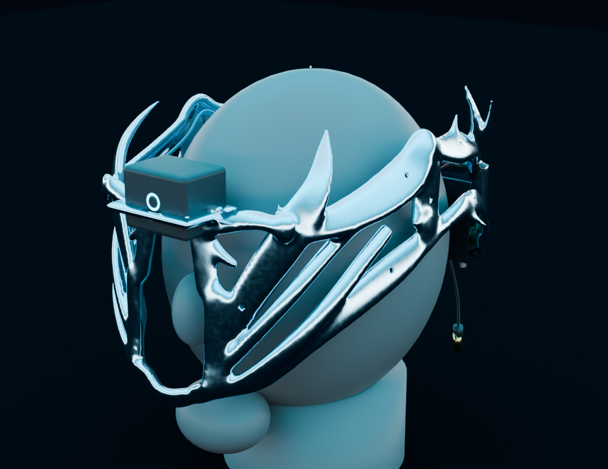
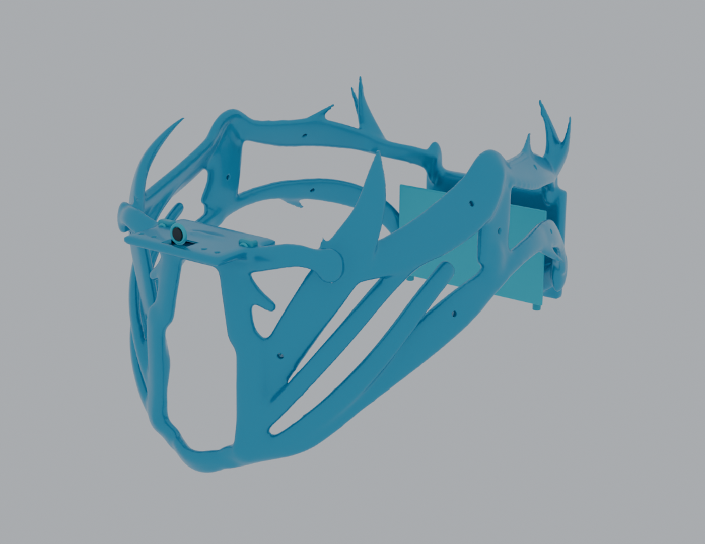
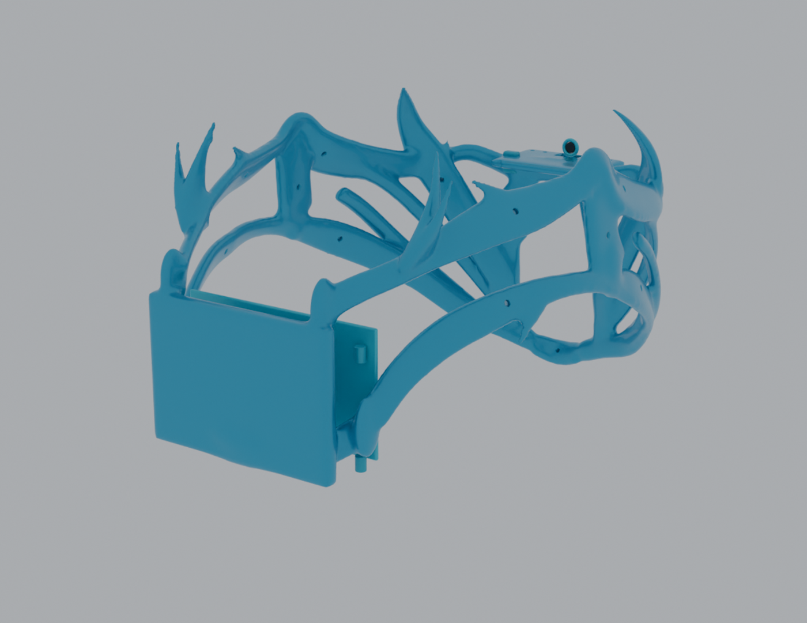
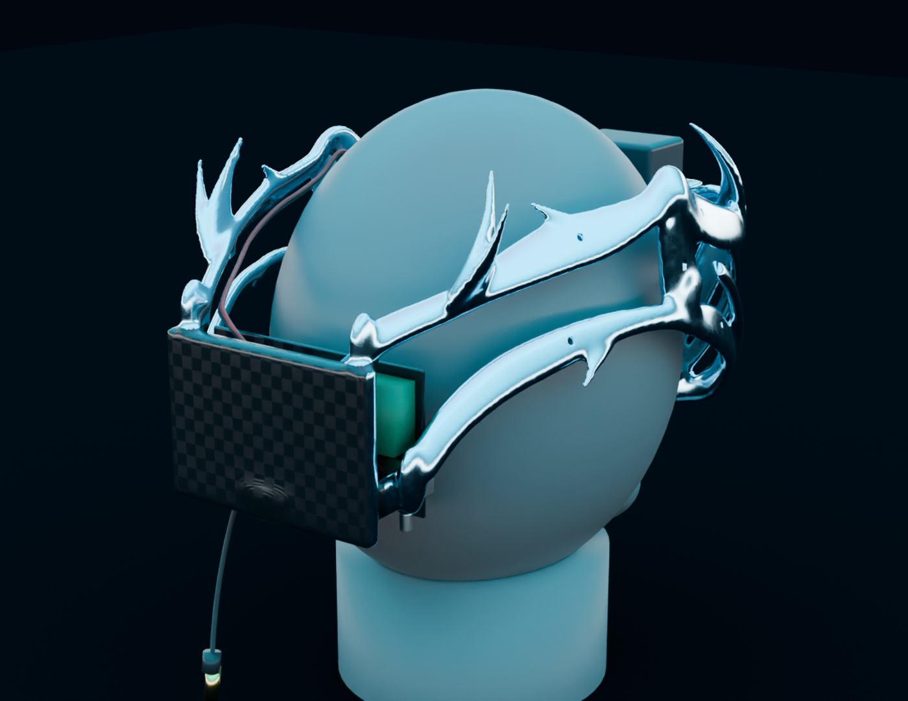
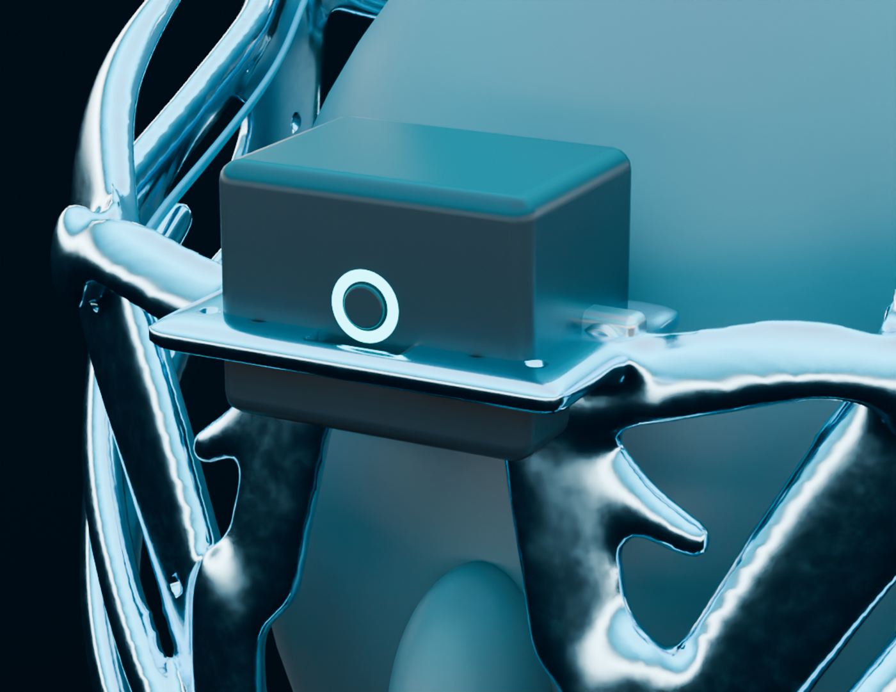
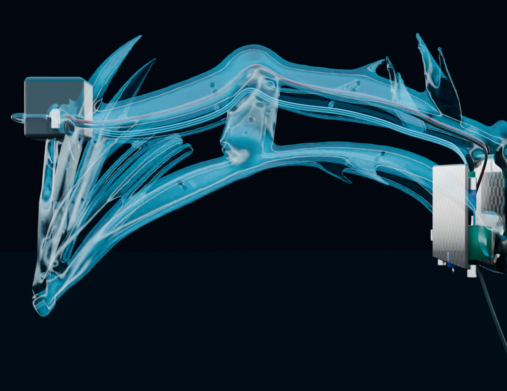
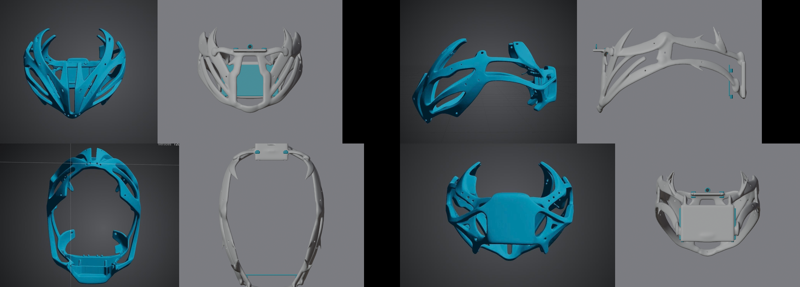

# EYEBORG

**Exoesqueleto orgánico azul · antropometría · electrónica · fabricación · modelo paramétrico en Blender**

Sistema vestible de estructura **abierta y ramificada** que integra cámara (ESP32-CAM), control inalámbrico (NodeMCU), alimentación autónoma prevista y salida de audio.
Este repositorio contiene el **modelo 3D paramétrico** (scripts de Blender), los **dos diseños** generados, las **referencias visuales** y la documentación derivada del *Expediente Técnico Integral* (rev. 20 de noviembre de 2026).

<p align="center">
  
</p>

> **Principio rector:** preservar la arquitectura abierta y ramificada de las ocho referencias azules. La integración electrónica se adapta a la estructura; no la convierte en una carcasa cerrada ni altera su silueta.

> ⚠️ **Estado: prototipo conceptual / blockout.** Nada de este repositorio es una certificación de ajuste, resistencia, seguridad eléctrica ni aptitud médica. Ver [Avisos](#avisos-y-validación-pendiente).

---

## Contenido

- [Vista rápida: los dos diseños](#vista-rápida-los-dos-diseños)
- [Empezar (ver los diseños en Blender)](#empezar-ver-los-diseños-en-blender)
- [Criterios de diseño](#criterios-de-diseño)
- [Antropometría verificada](#antropometría-verificada)
- [Componentes electrónicos](#componentes-electrónicos)
- [Parámetros CAD, holguras y fabricación](#parámetros-cad-holguras-y-fabricación)
- [Ergonomía aplicada al modelo](#ergonomía-aplicada-al-modelo)
- [Control de calidad del modelo](#control-de-calidad-del-modelo)
- [Arquitectura mecánica y modular](#arquitectura-mecánica-y-modular)
- [Arquitectura de software y red](#arquitectura-de-software-y-red)
- [Cableado y alimentación (conceptual)](#cableado-y-alimentación-conceptual)
- [Estructura del repositorio](#estructura-del-repositorio)
- [Scripts de Blender](#scripts-de-blender)
- [Referencias visuales](#referencias-visuales)
- [Plan de validación y riesgos](#plan-de-validación-y-riesgos)
- [Avisos y validación pendiente](#avisos-y-validación-pendiente)
- [Créditos y licencias](#créditos-y-licencias)

---

## Vista rápida: los dos diseños

| | **Diseño 1: estructura** | **Diseño 2: cableado + materiales** |
| --- | --- | --- |
| Archivo | [`output/EYEBORG.blend`](output/EYEBORG.blend) | [`output/EYEBORG_CABLEADO.blend`](output/EYEBORG_CABLEADO.blend) |
| Contenido | Exoesqueleto abierto de malla fusionada, plataforma de cámara con bolsa, agujeros de montaje, espinas de acento, módulos de referencia | Todo el diseño 1 **+** cableado discreto simulado (por la cara interna de los rieles), conectores, capacitores, componentes, maniquí esquemático, materiales procedurales (cromo azul, fibra de carbono, mangas de cable, emisivos) y estudio de iluminación con 4 cámaras |
| Uso | Evaluar forma, ergonomía y modularidad | Visualizar recorridos de cables y la estética final |

<table>
  <tr>
    <td></td>
    <td></td>
  </tr>
  <tr>
    <td align="center"><sub>Diseño 1 · isométrica frontal</sub></td>
    <td align="center"><sub>Diseño 1 · isométrica trasera</sub></td>
  </tr>
  <tr>
    <td></td>
    <td></td>
  </tr>
  <tr>
    <td align="center"><sub>Diseño 2 · placa occipital de fibra de carbono</sub></td>
    <td align="center"><sub>Diseño 2 · plataforma de cámara</sub></td>
  </tr>
  <tr>
    <td colspan="2"></td>
  </tr>
  <tr>
    <td colspan="2" align="center"><sub>Diseño 2 · vista en rayos X: potencia (rojo/negro) e I2S (cian) por la cara interna de los rieles, bandeja posterior a la derecha</sub></td>
  </tr>
</table>

### Comparación con las referencias azules

Izquierda: referencia (vistas azules). Derecha: modelo actual desde la misma dirección (frontal, lateral, superior, posterior).



---

## Empezar (ver los diseños en Blender)

La guía completa, pensada para personas **sin experiencia en comandos** (desde `git clone`, para **Mac y Windows**), está en:

### 👉 [`docs/INSTRUCCIONES.md`](docs/INSTRUCCIONES.md)

Resumen:

```bash
git clone https://github.com/rslnt1270/Navy_Project.git
cd Navy_Project
```

1. Instala **Blender 5.1 o superior** (https://www.blender.org/download/).
2. Abre Blender → pestaña **Scripting** → **Open** → `scripts/ver_disenos.py` → **Run Script ▶**.
3. Verás el **Diseño 1** (izquierda) y el **Diseño 2 con cableado** (derecha). `Alt + Z` activa rayos X para ver los cables.

---

## Criterios de diseño

Rasgos **obligatorios** a preservar (del expediente):

- Horquilla frontal inferior con abertura longitudinal central; no convertirla en una placa maciza.
- Dos ramas principales anchas que ascienden desde el vértice frontal hacia sienes y corona.
- Ramas laterales secundarias y ventanas alargadas, de lenguaje orgánico tipo nervadura ósea.
- Arcos superiores ascendentes con puntas redondeadas/afiladas, integrados a la estructura.
- Puente superior y puente posterior; placa occipital central con nervaduras de conexión.
- Acabado azul cian y superficies suaves; evitar ornamentos que cambien la silueta.

Cámara y electrónica van en **pods o bandejas discretas y extraíbles**; ante interferencias se modifica el alojamiento o la distribución, **no la silueta maestra**.

**Sistema de coordenadas CAD:** frente `-Y` · posterior `+Y` · arriba `+Z` · lado izquierdo del usuario `+X` · **1 unidad Blender = 1 mm**.

**Límite de fidelidad:** no se recibió una malla original (STL/OBJ) ni nube de puntos; el modelo es una **reconstrucción paramétrica a partir de vistas**, no una réplica exacta.

---

## Antropometría verificada

Medidas confirmadas por el usuario el 20/11/2026. Se conservan **literalmente**.

| Parámetro | Dato | Equivalencia CAD | Nota |
| --- | --- | --- | --- |
| Circunferencia de cabeza | 57 cm | 570 mm | Verificada |
| Curvatura | 27 × 35.5 cm | 270 × 355 mm | Ejes y recorrido no especificados |
| Lentes | 14 cm | 140 mm | Alcance de extremos no especificado |
| Distancia interpupilar (IPD) | 65 mm | 65 mm | Verificada |
| Mandíbula | 25 cm | 250 mm | Recorrido anatómico no especificado |
| Circunferencia de cuello | 38 cm | 380 mm | Verificada |
| Envolvente de cabeza (blockout) | 165 × 202 × 215 mm | X × Y × Z | Referencia CAD; **no es un escaneo 3D** |

No convertir *curvatura* ni *mandíbula* en perímetros, radios o anchos hasta definir el recorrido exacto de la cinta. Valores heredados de V6 (ceja–puente nasal 20 mm, puente–punta 40 mm, ancho de nariz 35 mm, eje de oído +6/−18 mm) siguen **pendientes de reconfirmación**.

---

## Componentes electrónicos

Dimensiones normalizadas a milímetros (L × A × H).

| Componente | L × A × H (mm) | Estado |
| --- | --- | --- |
| Batería LiPo BAT-LI-1000 | 36 × 18 × 6 | Conversión interpretada |
| TP4056 USB-C | 12 × 17 × 5 | Registrado; revisar puerto |
| MT3608 | 21 × 20 × 10 | Conversión interpretada |
| DAC PCM5102A | 32 × 18 × 15 | Aproximado |
| ESP32-CAM AI Thinker (sin MB) | 40 × 28 × 29 | Aproximado |
| NodeMCU ESP8266 ESP-12E | 49 × 26 × 13 | Provisional heredado |

**Conflicto abierto:** la celda se identifica como “BAT-LI-1000” pero la arquitectura registra 3.7 V / 500 mAh. Comprobar la etiqueta física antes de calcular autonomía o corriente de carga.
**Cámara:** el V6 reservaba 41.5 × 28 × 14.5 mm; el módulo completo mide 40 × 28 × 29 mm. El blockout usa un pod de 46 × 34 × 35 mm. No fabricar hasta comprobar la orientación física.

---

## Parámetros CAD, holguras y fabricación

Objetivos de diseño, **no tolerancias certificadas**:

| Parámetro | Valor | Clasificación |
| --- | --- | --- |
| Separación nominal cabeza–estructura | 6.0 mm | Objetivo de blockout |
| Acolchado EVA | 5.0 mm | Material previsto |
| Pared nominal | 3.2 mm | Parámetro heredado |
| Ventana libre del oído | 68 × 52 mm | Geometría heredada |
| Espacio mínimo sobre eje del oído | 26 mm | Geometría heredada |
| Límite inferior de nuca | Z = −80 mm | Geometría heredada |
| Ventana USB-C / buje jack | 10 × 4.5 mm / Ø6.0–6.5 mm | Provisional |

Reglas de fabricación: suavizar transiciones y **redondear puntas que puedan contactar con la piel**; mantener abiertas ventanas y nervaduras; **no fijar el patrón final de agujeros, insertos o clips** hasta elegir tornillería, material, impresora y orientación de capa; imprimir probetas de tolerancia (agujeros Ø6.0–7.0 mm en pasos de 0.2 mm; guías de 0.2–0.8 mm por lado).

---

## Ergonomía aplicada al modelo

Sobre la base del expediente, el modelo incorpora comprobaciones automáticas ([`tools/check_ergonomia.py`](tools/check_ergonomia.py)):

- **Holgura a la cabeza ≥ 6 mm** contra la envolvente elipsoidal verificada (165 × 202 × 215 mm). Cada correa se empuja automáticamente fuera del volumen de la cabeza.
- **Corredor nasal libre** de ±20.5 mm (de la muesca nasal del V6) en la zona de la nariz.
- **Ventana del oído** (68 × 52 mm) despejada.
- **Plataforma y barra de cámara** desplazadas hacia delante de la frente.

Resultado actual (medido sobre la malla final, [`tools/check_ergonomia.py`](tools/check_ergonomia.py)):

| Comprobación | Resultado |
| --- | --- |
| Vértices dentro del volumen de la cabeza | **0** |
| Holgura mínima a la cabeza | **8.7 mm** (objetivo ≥ 6 mm) |
| Vértices en la ventana del oído (68 × 52 mm) | **0** |
| Vértices dentro de la nariz / el mentón del maniquí esquemático | **0 / 0** |
| Vértices rozando el corredor nasal (±20.5 mm) | 4 (de 173 000) |

> La envolvente de cabeza es un elipsoide, **no un escaneo**; los valores nasales son heredados y están pendientes de reconfirmar. El maniquí del diseño 2 (nariz, mentón y cuello de 380 mm de circunferencia) es **esquemático**. Validar con prototipo de baja resolución.

---

## Control de calidad del modelo

Auditoría estructural automática ([`tools/auditar.py`](tools/auditar.py)) sobre ambos `.blend`:

| Comprobación | Diseño 1 | Diseño 2 |
| --- | --- | --- |
| Malla estructural (`EYEBORG_FUSION`) | 172 397 caras | 172 397 caras |
| Aristas no manifold / vértices sueltos / caras degeneradas | 0 / 0 / 0 | 0 / 0 / 0 |
| Islas desconectadas | 1 (una sola pieza) | 1 (una sola pieza) |
| Normales (volumen con signo positivo) | ✔ 249 cm³ | ✔ 249 cm³ |
| Dimensiones (X × Y × Z) | 194 × 283 × 159 mm | 194 × 283 × 159 mm |
| Objetos duplicados `.001` / datos huérfanos / sin material | 0 / 0 / 0 | 0 / 0 / 0 |
| Espesor de pared: mediana / p95 | 6.2 / 14.2 mm | 6.2 / 14.2 mm |
| Muestras con espesor < 1.2 mm | 6.4 % (puntas de espina) | 6.4 % (puntas de espina) |

- **Peso:** el volumen de la estructura es de ≈ 249 cm³; como orden de magnitud, ≈ 0.31 kg si fuera macizo en PLA (1.24 g/cm³). Con paredes y relleno parcial será bastante menor. **Estimación, no validada.**
- **Puntas finas:** el ~6 % de espesor < 1.2 mm corresponde a las puntas de aguja de las espinas, por debajo de lo que imprime una boquilla estándar: redondearlas o engrosarlas antes de imprimir.
- La malla es estanca (manifold), pero **no se ha probado en un laminador (slicer) ni impresa**.

---

## Arquitectura mecánica y modular

| Zona | Componentes / función | Criterio |
| --- | --- | --- |
| Puente superior frontal | ESP32-CAM sin adaptador MB | Orientación de lente, pines y altura por confirmar |
| Módulo occipital / bandeja posterior | NodeMCU, LiPo, TP4056, MT3608, PCM5102A | Distribución exacta pendiente; masas, calor, conectores, acceso |
| Salida de audio | Cable del PCM5102A a amplificador externo | El amplificador queda fuera del casco |
| Arcos y ramas laterales | Estructura portante y estética abierta | No modificar el perfil principal para introducir electrónica |

Seguridad mecánica: no comprimir, perforar ni atrapar la LiPo; evitar contacto con ojos, nariz, orejas y vías respiratorias; mantener acceso para retirada rápida; verificar visión periférica y reparto de peso.

---

## Arquitectura de software y red

| Identificador | Hardware | Función |
| --- | --- | --- |
| `EYEBORG_CORE` | ESP32-CAM AI Thinker | Cámara, captura, servidor HTTP/MJPEG, Wi-Fi como cliente (STA) |
| `EYEBORG_CONTROL` | NodeMCU ESP8266 ESP-12E | Punto de acceso Wi-Fi (AP), coordinación y control |
| Terminal externa | Samsung Tab S10 FE+ | Cliente Wi-Fi, interfaz y procesamiento externo |
| Audio | PCM5102A | DAC I2S; integración pendiente |

La NodeMCU crea el AP local `EYEBORG_CONTROL`; la ESP32-CAM y la tableta son clientes. No se requiere Internet. Video por **HTTP/MJPEG**; UDP contemplado para instrucciones. **No** se requiere RX/TX cableado entre NodeMCU y ESP32-CAM.
Usar `CAMERA_MODEL_AI_THINKER`. No asignar pines I2S/control sin revisar el sketch real (la cámara ocupa muchos GPIO).

---

## Cableado y alimentación (conceptual)

Secuencia lógica prevista: **LiPo 3.7 V → TP4056 (carga/protección según variante) → interruptor y protección → MT3608 (ajustar y medir) → bus regulado ~5 V** para las placas compatibles, y riel específico para el PCM5102A.

El **Diseño 2** visualiza este concepto con cables por la cara interna de los rieles (potencia por el riel izquierdo; bus I2S por el derecho), conectores JST, tres capacitores de desacople y salida de audio.

> ⛔ **No es un esquema de cableado terminal-a-terminal listo para energizar.** Antes de conectar: identificar la variante exacta de TP4056, el pinout de cada placa y las tensiones/corrientes reales; ajustar y medir el MT3608 con fuente limitada en corriente; medir consumos pico; dimensionar interruptor, fusible y conductores; **no** asignar GPIO I2S sin revisar el sketch; **no** aplicar 5 V al pin 3V3; **no** afirmar autonomía (500 mAh no está validado). Las **capacitancias están por definir**.

---

## Estructura del repositorio

```text
Navy_Project/
├── README.md
├── docs/
│   ├── INSTRUCCIONES.md        # Guía paso a paso Mac y Windows (desde git clone)
│   ├── SPEC.md                 # Especificación del modelado
│   ├── PLAN.md                 # Plan y estado
│   └── img/                    # Renders usados en este README
├── scripts/                    # Modelo paramétrico en Python (Blender)
│   ├── ver_disenos.py          # ← Muestra diseño 1 y diseño 2 en Blender
│   ├── 00_construir_conjunto.py        # Ensambla el diseño 1
│   ├── 00_construir_cableado.py        # Ensambla el diseño 2
│   ├── eyeborg_part_01 … 13_*.py       # Módulos por pieza
│   ├── _eyeborg_core.py / _eyeborg_materials.py / _eyeborg_studio.py
│   └── eyeborg_config.json     # Parámetros (medidas, holguras, espinas…)
├── output/
│   ├── EYEBORG.blend           # Diseño 1 (acabado azul satinado)
│   └── EYEBORG_CABLEADO.blend  # Diseño 2
├── references/
│   ├── azules/                 # 8 vistas azules (geometría maestra) + lámina del expediente
│   └── estetica/               # Referencias de estética cyborg / cyberpunk
└── tools/                      # Auditoría, chequeo ergonómico, renders y comparación
```

---

## Scripts de Blender

| Archivo | Función |
| --- | --- |
| `ver_disenos.py` | **Visor**: carga ambos `.blend` lado a lado (punto de entrada para quien solo quiere mirar) |
| `00_construir_conjunto.py` | Ensambla las colecciones `EYEBORG_00 … 12` (diseño 1) |
| `00_construir_cableado.py` | Diseño 1 + cableado + materiales + estudio (diseño 2) |
| `eyeborg_part_01_columna_frontal.py` | Punta con ranura y paredes internas |
| `eyeborg_part_02_corona_y_puentes.py` | Barra de cámara y brazos |
| `eyeborg_part_03_soporte_camara.py` | Pod de cámara y plataforma |
| `eyeborg_part_04/05_rama_*.py` | Ramas izquierda / derecha (diagonal, rieles, abanico, espinas, nodos) |
| `eyeborg_part_06_modulo_occipital.py` | Placa occipital |
| `eyeborg_part_07_arcos_occipitales.py` | Barra posterior |
| `eyeborg_part_08_portacomponentes.py` | Bandeja y volúmenes de componentes |
| `eyeborg_part_09_uniones_modulares.py` | Marcadores de unión |
| `eyeborg_part_10_referencia_anatomica.py` | Elipsoide de cabeza y envolvente de holgura (no imprimible) |
| `eyeborg_part_11_fusion.py` | Fusión orgánica de la estructura (voxel remesh + suavizado) |
| `eyeborg_part_12_agujeros.py` | Agujeros de montaje y bolsa de la plataforma de cámara |
| `eyeborg_part_13_cableado.py` | Cables, conectores y capacitores simulados |
| `90_cotejo_dimensional.py` | Imprime el cotejo de parámetros y estados |

Los objetos `REF_*` son **referencias dimensionales**, no piezas de impresión: ocultarlos antes de exportar STL.

---

## Referencias visuales

- **`references/azules/`**: las **ocho vistas azules** del usuario (autoridad visual de la revisión). No sustituyen una malla fuente. `ocho_vistas_expediente.png` es la lámina del expediente.
- **`references/estetica/`**: imágenes de inspiración (cromo líquido, espinas afiladas, nervaduras orgánicas, estética cyborg-cyberpunk) usadas como guía de lenguaje formal.

---

## Plan de validación y riesgos

| Área | Pendiente |
| --- | --- |
| Antropometría | Definir recorrido de “curvatura 27 × 35.5 cm” y “mandíbula 25 cm”; comparar la envolvente con el usuario |
| Ergonomía | Visión periférica, respiración, acceso a ojos, retirada rápida; prototipo económico de la horquilla y ramas |
| Mecánica | Seleccionar tornillos/insertos; confirmar que no toca orejas ni comprime la LiPo |
| Electrónica | Medir cada módulo; resolver variante TP4056; medir picos y temperaturas; rieles, protección y calibre de cables; **definir capacitancias** |
| Audio | Asignar GPIO I2S tras revisar el sketch completo de la cámara |
| Fabricación | Inspeccionar normales, espesores y no-manifold; cupones de tolerancia; **redondear puntas** |
| Software | Integrar y probar NodeMCU AP + ESP32-CAM STA + tableta; validar MJPEG/UDP sin Internet |

Riesgos principales: fidelidad geométrica (reconstrucción desde vistas), ajuste anatómico (blockout, no escaneo), conflicto dimensional de cámara, energía (capacidad de batería discrepante, sin medición de picos), uniones y material sin definir, audio sin GPIO asignados.

---

## Avisos y validación pendiente

- Los archivos `.py` se han ejecutado en **Blender 5.1.2** y los modelos se generan sin errores; la malla pasa la auditoría estructural (manifold, una sola pieza), pero **no** se ha probado en un laminador ni impresa.
- Las **espinas** son decorativas y de punta aguda: comprobar que ninguna contacte piel, ojos u oídos y redondear la punta al imprimir.
- El **cableado** del diseño 2 es una **simulación visual**; no autoriza conectar ni energizar nada.
- Conservar las etiquetas *provisional*, *pendiente* y *no energizar* al compartir este material.

---

## Créditos y licencias

- Documento fuente: *EYEBORG · Expediente Técnico Integral* (rev. 20 nov 2026).
- Las imágenes de `references/estetica/` son **material de inspiración de terceros** recopilado de internet; **pertenecen a sus autores** y no se ofrecen bajo la licencia del proyecto. Si eres autor y deseas que se retire alguna, abre un *issue*.
- **Licencia del código y modelos: pendiente de definir** por los responsables del proyecto.
