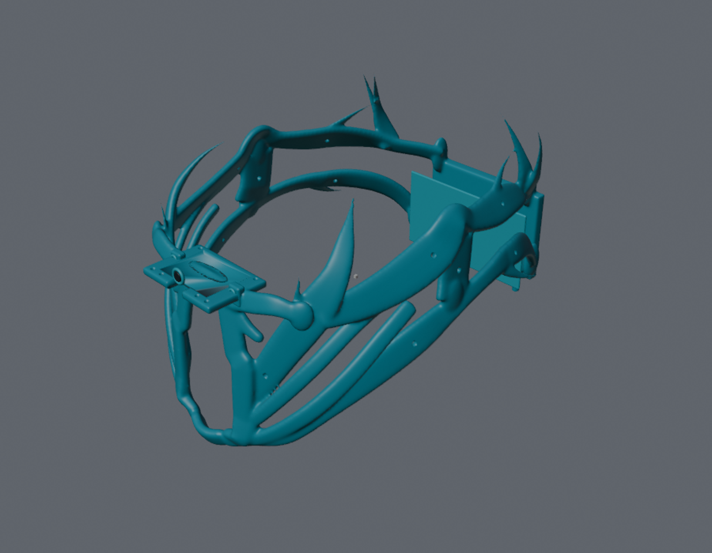

# v1 · Primer modelo

> Versión **archivada** (solo lectura). La versión actual está en [`../../modelos/`](../../modelos/) y [`../../vistas/`](../../vistas/).
> Origen: commit `911d088` del 20/11/2026, 16:18 h. Para volver a este punto del repositorio: `git checkout 911d088`.

## Qué es
Primera versión publicada: estructura paramétrica de esqueleto 3D (diagonal con cuerno, rieles, correas de abanico, paredes de la ranura nasal y horquilla de punta), fusión orgánica, plataforma de cámara con bolsa, agujeros de montaje y espinas de acento.

## Contenido
- **Diseños:** 2: `EYEBORG.blend` (estructura, azul satinado) y `EYEBORG_CABLEADO.blend` (cableado + cromo azulado).
- **Archivos:** `modelos/EYEBORG.blend`, `modelos/EYEBORG_CABLEADO.blend`, `imagenes/` (renders de esa época).
- **Maniquí:** Elipsoide de cabeza + nariz/mentón sueltos (solo referencia).

## Métricas
Estructura del diseño 1 medida **hoy** con `tools/auditar.py` y `tools/campo_visual.py` (mismos ojos reales de la malla CC0 → comparable entre v1-v3 y la actual).

| Métrica | Valor |
| --- | --- |
| Campo visual central / medio / periférico bloqueado (medido hoy) | 79.5 / 51.1 / 69.9 % |
| Ventana de la ranura bloqueada (medido hoy) | — |
| Medido en su momento | no medido |

## Problemas conocidos
41 islas desconectadas (puntas de espina desprendidas por el remallado); ergonomía solo contra un elipsoide.

## Cómo abrirla en Blender
1. Abre `scripts/ver_disenos.py` en Blender (pestaña *Scripting*).
2. Cambia la línea `VERSION = ''` por `VERSION = 'v1_primer_modelo'` y pulsa *Run Script*.
3. Cuando termines, vuelve a poner `VERSION = ''` para ver la versión actual.

Siguiente versión: v2.
