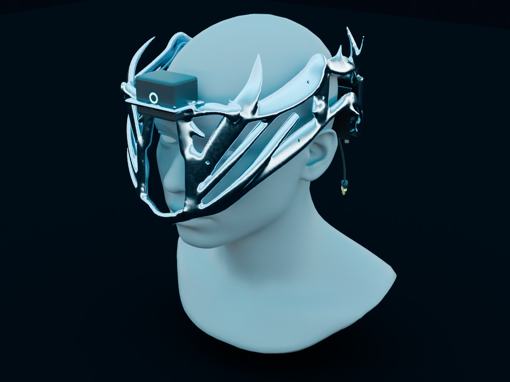

# v2 · Pulido y ergonomía

> Versión **archivada** (solo lectura). La versión actual está en [`../../modelos/`](../../modelos/) y [`../../vistas/`](../../vistas/).
> Origen: commit `5f14621` del 20/11/2026, 16:35 h. Para volver a este punto del repositorio: `git checkout 5f14621`.

## Qué es
Misma estructura que v1, pero **estanca y de una sola pieza** (segundo remallado y suavizado que conserva volumen), diseño 1 con acabado propio, maniquí esquemático (nariz, mentón, cuello), suelo mate y entorno de reflejos para el cromo; añade `tools/auditar.py` y el chequeo ergonómico.

## Contenido
- **Diseños:** 2: `EYEBORG.blend` y `EYEBORG_CABLEADO.blend`.
- **Archivos:** `modelos/EYEBORG.blend`, `modelos/EYEBORG_CABLEADO.blend`, `imagenes/` (renders de esa época).
- **Maniquí:** cabeza **realista de malla base CC0** (Blender Studio) escalada a las medidas, **añadida a posteriori** a esta versión (sin tocar su estructura). El maniquí original era: elipsoides con nariz, mentón y cuello.

## Métricas
Estructura del diseño 1 medida **hoy** con `tools/auditar.py` y `tools/campo_visual.py` (mismos ojos reales de la malla CC0 → comparable entre v1-v3 y la actual).

| Métrica | Valor |
| --- | --- |
| Campo visual central / medio / periférico bloqueado (medido hoy) | 71.5 / 47.7 / 66.2 % |
| Ventana de la ranura bloqueada (medido hoy) | — |
| Medido en su momento | no medido todavía (la herramienta de campo visual se creó después) |

## Ajuste de esta versión a la cabeza realista
Medido con `tools/check_ergonomia.py` y `tools/campo_visual.py` (diseño 1 de la versión, estructura **sin modificar**, sobre la cabeza CC0 escalada).

| Comprobación | Resultado |
| --- | --- |
| Vértices dentro de la piel | **0** |
| Vértices a menos de 4 mm de la piel | 7 |
| Holgura mínima a la piel (fuera de anclajes) | **4.0 mm** (objetivo ≥ 6 mm) ✘ |
| Distancia estructura–córnea | 23.7 mm |
| Vértices en la ventana de oreja (68 × 52 mm) | 0 |
| Campo visual central bloqueado | 71.5 % |
| Almohadillas de anclaje | no tiene |

> Esta versión no se diseñó para esta cabeza; las cifras muestran **cómo se habría comportado** y justifican los cambios de la versión siguiente.

## Problemas conocidos
El frente sigue cruzando la mirada; el cromo azulado se veía poco profesional.

## Cómo abrirla en Blender
1. Abre `scripts/ver_disenos.py` en Blender (pestaña *Scripting*).
2. Cambia la línea `VERSION = ''` por `VERSION = 'v2_pulido_ergonomia'` y pulsa *Run Script*.
3. Cuando termines, vuelve a poner `VERSION = ''` para ver la versión actual.

Siguiente versión: v3.
