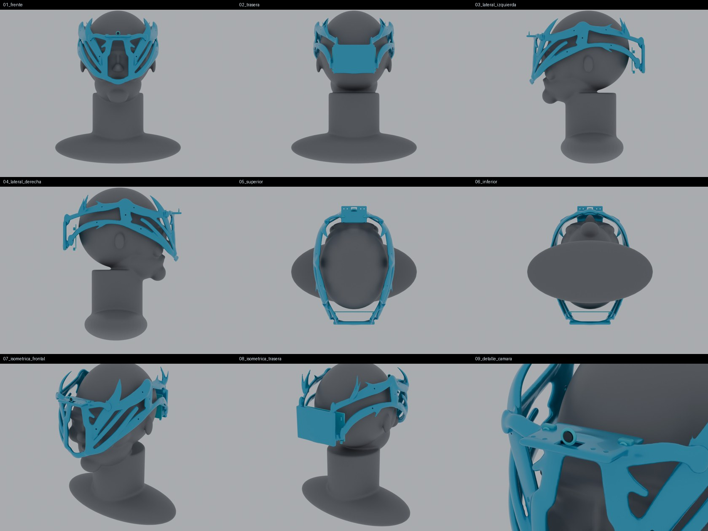
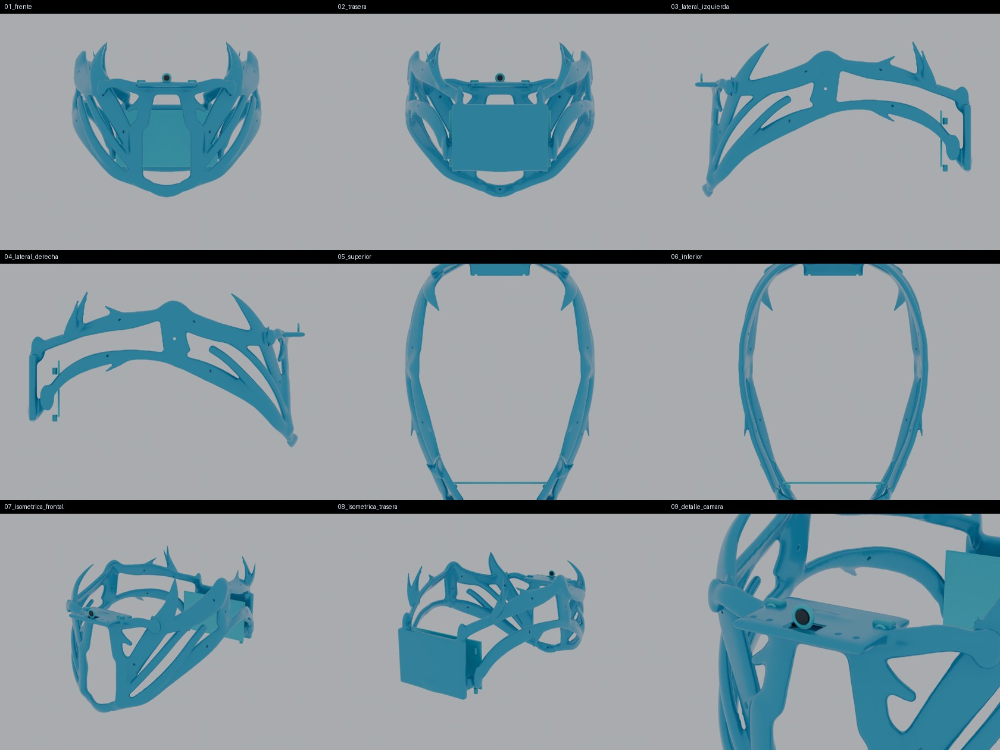
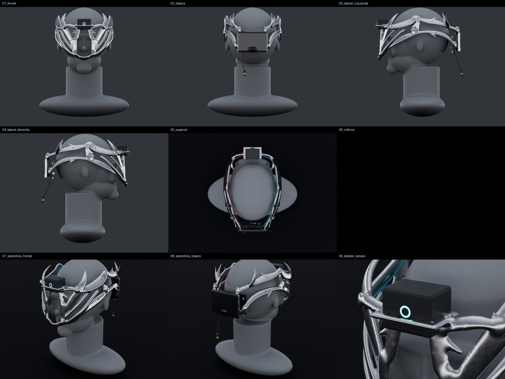
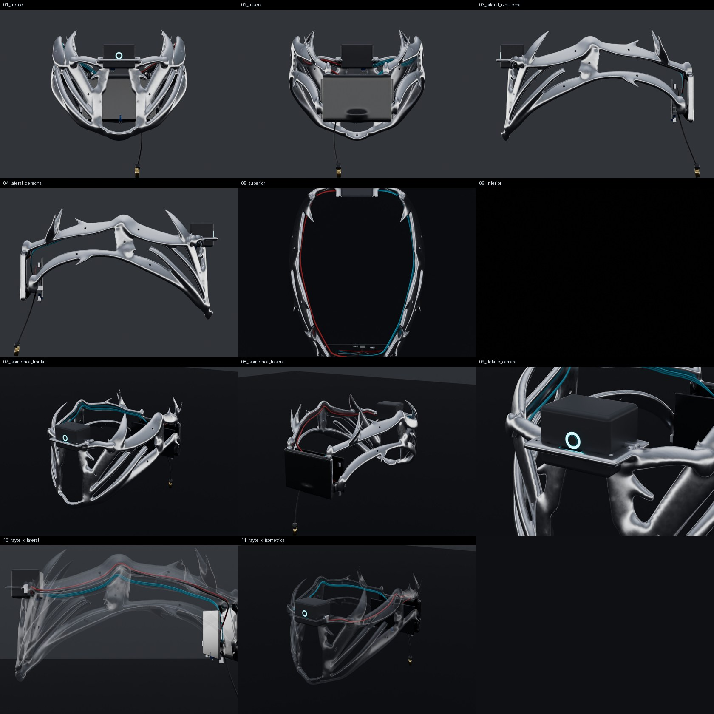
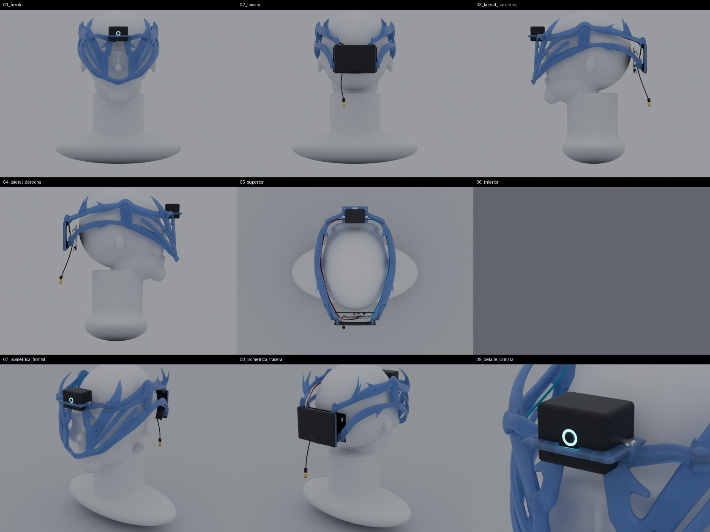
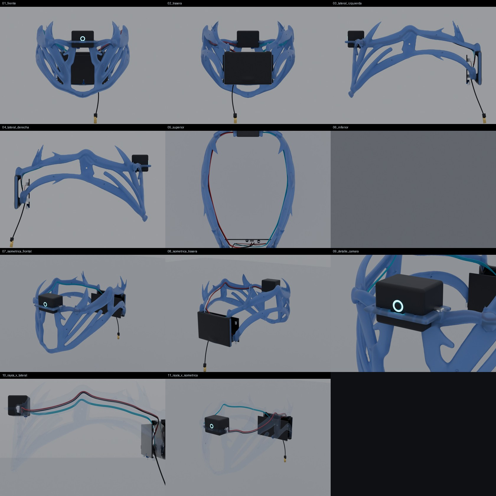

# Vistas de los diseños EYEBORG

Imágenes de cada vista de los tres diseños, **con y sin maniquí esquemático** (cráneo 165 × 202 × 215 mm, nariz, mentón y cuello de 380 mm; no es un escaneo).

Vistas ortográficas: frente, trasera, lateral izquierda/derecha (del usuario), superior e inferior. Perspectivas: isométrica frontal, isométrica trasera y detalle de la cámara. Los diseños 2 y 3 añaden vistas en rayos X del cableado (solo sin maniquí).

> Generadas con `tools/render_vistas.py` (Blender Cycles). Los archivos fuente están en `modelos/`.

## Diseño 1 · Estructura (azul satinado)

Archivo: `modelos/EYEBORG.blend`

### Con maniquí

| Vista | Archivo |
| --- | --- |
| 01 frente | [`diseno_1/con_maniqui/01_frente.jpg`](diseno_1/con_maniqui/01_frente.jpg) |
| 02 trasera | [`diseno_1/con_maniqui/02_trasera.jpg`](diseno_1/con_maniqui/02_trasera.jpg) |
| 03 lateral izquierda | [`diseno_1/con_maniqui/03_lateral_izquierda.jpg`](diseno_1/con_maniqui/03_lateral_izquierda.jpg) |
| 04 lateral derecha | [`diseno_1/con_maniqui/04_lateral_derecha.jpg`](diseno_1/con_maniqui/04_lateral_derecha.jpg) |
| 05 superior | [`diseno_1/con_maniqui/05_superior.jpg`](diseno_1/con_maniqui/05_superior.jpg) |
| 06 inferior | [`diseno_1/con_maniqui/06_inferior.jpg`](diseno_1/con_maniqui/06_inferior.jpg) |
| 07 isometrica frontal | [`diseno_1/con_maniqui/07_isometrica_frontal.jpg`](diseno_1/con_maniqui/07_isometrica_frontal.jpg) |
| 08 isometrica trasera | [`diseno_1/con_maniqui/08_isometrica_trasera.jpg`](diseno_1/con_maniqui/08_isometrica_trasera.jpg) |
| 09 detalle camara | [`diseno_1/con_maniqui/09_detalle_camara.jpg`](diseno_1/con_maniqui/09_detalle_camara.jpg) |

### Sin maniquí

| Vista | Archivo |
| --- | --- |
| 01 frente | [`diseno_1/sin_maniqui/01_frente.jpg`](diseno_1/sin_maniqui/01_frente.jpg) |
| 02 trasera | [`diseno_1/sin_maniqui/02_trasera.jpg`](diseno_1/sin_maniqui/02_trasera.jpg) |
| 03 lateral izquierda | [`diseno_1/sin_maniqui/03_lateral_izquierda.jpg`](diseno_1/sin_maniqui/03_lateral_izquierda.jpg) |
| 04 lateral derecha | [`diseno_1/sin_maniqui/04_lateral_derecha.jpg`](diseno_1/sin_maniqui/04_lateral_derecha.jpg) |
| 05 superior | [`diseno_1/sin_maniqui/05_superior.jpg`](diseno_1/sin_maniqui/05_superior.jpg) |
| 06 inferior | [`diseno_1/sin_maniqui/06_inferior.jpg`](diseno_1/sin_maniqui/06_inferior.jpg) |
| 07 isometrica frontal | [`diseno_1/sin_maniqui/07_isometrica_frontal.jpg`](diseno_1/sin_maniqui/07_isometrica_frontal.jpg) |
| 08 isometrica trasera | [`diseno_1/sin_maniqui/08_isometrica_trasera.jpg`](diseno_1/sin_maniqui/08_isometrica_trasera.jpg) |
| 09 detalle camara | [`diseno_1/sin_maniqui/09_detalle_camara.jpg`](diseno_1/sin_maniqui/09_detalle_camara.jpg) |

## Diseño 2 · Cromo satinado + cableado

Archivo: `modelos/EYEBORG_CABLEADO.blend`

### Con maniquí

| Vista | Archivo |
| --- | --- |
| 01 frente | [`diseno_2/con_maniqui/01_frente.jpg`](diseno_2/con_maniqui/01_frente.jpg) |
| 02 trasera | [`diseno_2/con_maniqui/02_trasera.jpg`](diseno_2/con_maniqui/02_trasera.jpg) |
| 03 lateral izquierda | [`diseno_2/con_maniqui/03_lateral_izquierda.jpg`](diseno_2/con_maniqui/03_lateral_izquierda.jpg) |
| 04 lateral derecha | [`diseno_2/con_maniqui/04_lateral_derecha.jpg`](diseno_2/con_maniqui/04_lateral_derecha.jpg) |
| 05 superior | [`diseno_2/con_maniqui/05_superior.jpg`](diseno_2/con_maniqui/05_superior.jpg) |
| 06 inferior | [`diseno_2/con_maniqui/06_inferior.jpg`](diseno_2/con_maniqui/06_inferior.jpg) |
| 07 isometrica frontal | [`diseno_2/con_maniqui/07_isometrica_frontal.jpg`](diseno_2/con_maniqui/07_isometrica_frontal.jpg) |
| 08 isometrica trasera | [`diseno_2/con_maniqui/08_isometrica_trasera.jpg`](diseno_2/con_maniqui/08_isometrica_trasera.jpg) |
| 09 detalle camara | [`diseno_2/con_maniqui/09_detalle_camara.jpg`](diseno_2/con_maniqui/09_detalle_camara.jpg) |

### Sin maniquí

| Vista | Archivo |
| --- | --- |
| 01 frente | [`diseno_2/sin_maniqui/01_frente.jpg`](diseno_2/sin_maniqui/01_frente.jpg) |
| 02 trasera | [`diseno_2/sin_maniqui/02_trasera.jpg`](diseno_2/sin_maniqui/02_trasera.jpg) |
| 03 lateral izquierda | [`diseno_2/sin_maniqui/03_lateral_izquierda.jpg`](diseno_2/sin_maniqui/03_lateral_izquierda.jpg) |
| 04 lateral derecha | [`diseno_2/sin_maniqui/04_lateral_derecha.jpg`](diseno_2/sin_maniqui/04_lateral_derecha.jpg) |
| 05 superior | [`diseno_2/sin_maniqui/05_superior.jpg`](diseno_2/sin_maniqui/05_superior.jpg) |
| 06 inferior | [`diseno_2/sin_maniqui/06_inferior.jpg`](diseno_2/sin_maniqui/06_inferior.jpg) |
| 07 isometrica frontal | [`diseno_2/sin_maniqui/07_isometrica_frontal.jpg`](diseno_2/sin_maniqui/07_isometrica_frontal.jpg) |
| 08 isometrica trasera | [`diseno_2/sin_maniqui/08_isometrica_trasera.jpg`](diseno_2/sin_maniqui/08_isometrica_trasera.jpg) |
| 09 detalle camara | [`diseno_2/sin_maniqui/09_detalle_camara.jpg`](diseno_2/sin_maniqui/09_detalle_camara.jpg) |
| 10 rayos x lateral | [`diseno_2/sin_maniqui/10_rayos_x_lateral.jpg`](diseno_2/sin_maniqui/10_rayos_x_lateral.jpg) |
| 11 rayos x isometrica | [`diseno_2/sin_maniqui/11_rayos_x_isometrica.jpg`](diseno_2/sin_maniqui/11_rayos_x_isometrica.jpg) |

## Diseño 3 · Resina translúcida + cableado

Archivo: `modelos/EYEBORG_CABLEADO_MATE.blend`

### Con maniquí

| Vista | Archivo |
| --- | --- |
| 01 frente | [`diseno_3/con_maniqui/01_frente.jpg`](diseno_3/con_maniqui/01_frente.jpg) |
| 02 trasera | [`diseno_3/con_maniqui/02_trasera.jpg`](diseno_3/con_maniqui/02_trasera.jpg) |
| 03 lateral izquierda | [`diseno_3/con_maniqui/03_lateral_izquierda.jpg`](diseno_3/con_maniqui/03_lateral_izquierda.jpg) |
| 04 lateral derecha | [`diseno_3/con_maniqui/04_lateral_derecha.jpg`](diseno_3/con_maniqui/04_lateral_derecha.jpg) |
| 05 superior | [`diseno_3/con_maniqui/05_superior.jpg`](diseno_3/con_maniqui/05_superior.jpg) |
| 06 inferior | [`diseno_3/con_maniqui/06_inferior.jpg`](diseno_3/con_maniqui/06_inferior.jpg) |
| 07 isometrica frontal | [`diseno_3/con_maniqui/07_isometrica_frontal.jpg`](diseno_3/con_maniqui/07_isometrica_frontal.jpg) |
| 08 isometrica trasera | [`diseno_3/con_maniqui/08_isometrica_trasera.jpg`](diseno_3/con_maniqui/08_isometrica_trasera.jpg) |
| 09 detalle camara | [`diseno_3/con_maniqui/09_detalle_camara.jpg`](diseno_3/con_maniqui/09_detalle_camara.jpg) |

### Sin maniquí

| Vista | Archivo |
| --- | --- |
| 01 frente | [`diseno_3/sin_maniqui/01_frente.jpg`](diseno_3/sin_maniqui/01_frente.jpg) |
| 02 trasera | [`diseno_3/sin_maniqui/02_trasera.jpg`](diseno_3/sin_maniqui/02_trasera.jpg) |
| 03 lateral izquierda | [`diseno_3/sin_maniqui/03_lateral_izquierda.jpg`](diseno_3/sin_maniqui/03_lateral_izquierda.jpg) |
| 04 lateral derecha | [`diseno_3/sin_maniqui/04_lateral_derecha.jpg`](diseno_3/sin_maniqui/04_lateral_derecha.jpg) |
| 05 superior | [`diseno_3/sin_maniqui/05_superior.jpg`](diseno_3/sin_maniqui/05_superior.jpg) |
| 06 inferior | [`diseno_3/sin_maniqui/06_inferior.jpg`](diseno_3/sin_maniqui/06_inferior.jpg) |
| 07 isometrica frontal | [`diseno_3/sin_maniqui/07_isometrica_frontal.jpg`](diseno_3/sin_maniqui/07_isometrica_frontal.jpg) |
| 08 isometrica trasera | [`diseno_3/sin_maniqui/08_isometrica_trasera.jpg`](diseno_3/sin_maniqui/08_isometrica_trasera.jpg) |
| 09 detalle camara | [`diseno_3/sin_maniqui/09_detalle_camara.jpg`](diseno_3/sin_maniqui/09_detalle_camara.jpg) |
| 10 rayos x lateral | [`diseno_3/sin_maniqui/10_rayos_x_lateral.jpg`](diseno_3/sin_maniqui/10_rayos_x_lateral.jpg) |
| 11 rayos x isometrica | [`diseno_3/sin_maniqui/11_rayos_x_isometrica.jpg`](diseno_3/sin_maniqui/11_rayos_x_isometrica.jpg) |

