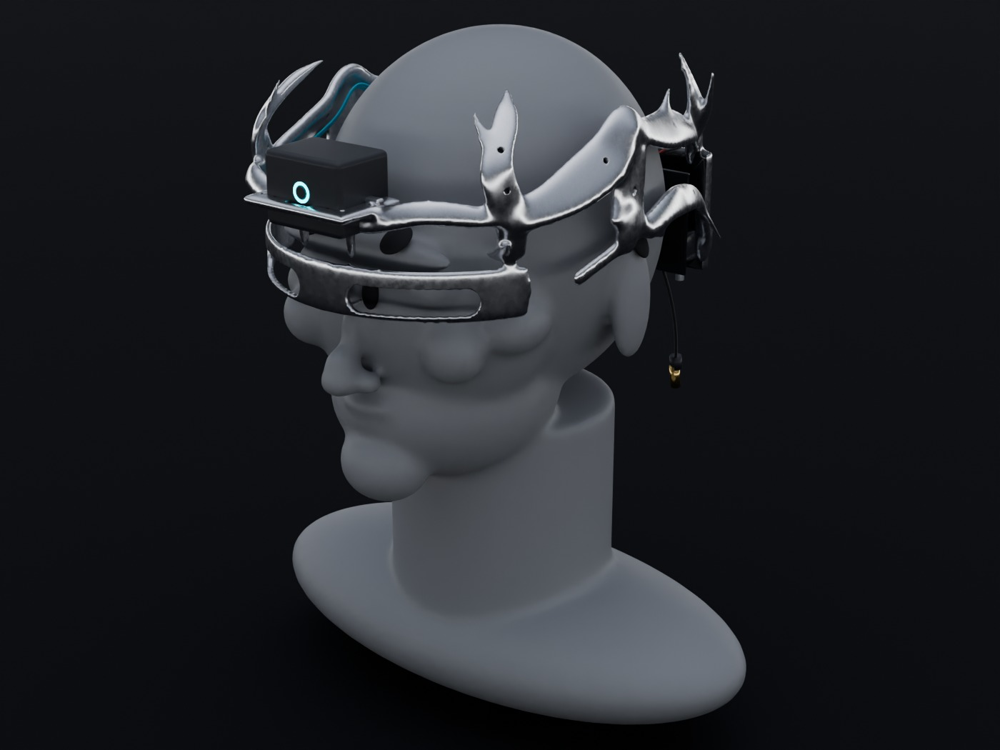

# v4 · Visor inuit (maniquí de elipsoides)

> Versión **archivada** (solo lectura). La versión actual está en [`../../modelos/`](../../modelos/) y [`../../vistas/`](../../vistas/).
> Origen: commit `663bcda` del 20/11/2026, 22:17 h. Para volver a este punto del repositorio: `git checkout 663bcda`.

## Qué es
Primer rediseño anatómico: **visor tipo lentes inuit** con ranuras 48 × 14 mm, 6 almohadillas de anclaje (nariz, frente, oreja), brazos de sien, corona abierta con alas y espinas; sin diagonales ni horquilla cruzando los ojos. Incluye la simulación de movimientos del cuello.

## Contenido
- **Diseños:** 3: igual que v3 (estructura, cromo satinado, resina translúcida).
- **Archivos:** `modelos/EYEBORG.blend`, `modelos/EYEBORG_CABLEADO.blend`, `modelos/EYEBORG_CABLEADO_MATE.blend`, galería `vistas/` (con y sin maniquí), `simulaciones/` (movimiento del cuello), `imagenes/` (renders de esa época).
- **Maniquí:** Elipsoides con proporciones de literatura (aún sin malla CC0).

## Métricas
Estructura del diseño 1 medida **hoy** con `tools/auditar.py` y `tools/campo_visual.py` (mismos ojos reales de la malla CC0 → comparable entre v1-v3 y la actual).

| Métrica | Valor |
| --- | --- |
| Campo visual central / medio / periférico bloqueado (medido hoy) | 26.6 / 23.9 / 22.6 % |
| Ventana de la ranura bloqueada (medido hoy) | 22.0 % (no comparable: la ranura se diseñó para ojos estimados a z = +6 mm; con los ojos reales de la malla CC0 quedan a z = +2.3 mm) |
| Medido en su momento | campo central 30.5 %, ventana de la ranura 1.0 %, distancia a la córnea 17.0 mm, holgura 5.9 mm, 6/6 anclajes |

## Problemas conocidos
Maniquí poco realista; los ojos estaban estimados 10 mm más adelante de lo que resultó con la malla real. Motivo de la versión actual.

## Cómo abrirla en Blender
1. Abre `scripts/ver_disenos.py` en Blender (pestaña *Scripting*).
2. Cambia la línea `VERSION = ''` por `VERSION = 'v4_visor_inuit_maniqui_elipsoides'` y pulsa *Run Script*.
3. Cuando termines, vuelve a poner `VERSION = ''` para ver la versión actual.

Siguiente versión: la versión actual.
